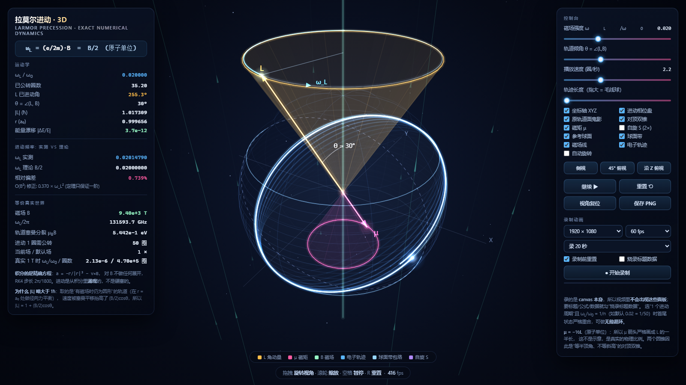
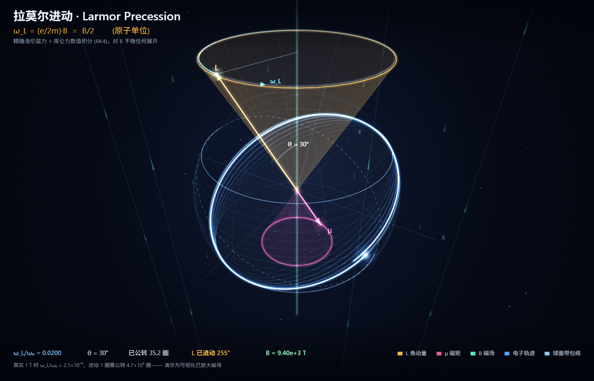
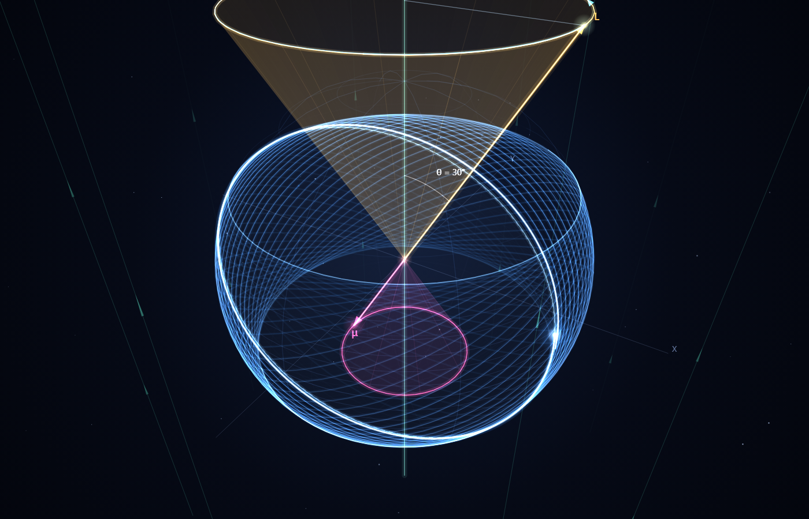

# physics
物理演示动画 —— 用程序把物理规律**跑出来**，而不是画出来。

每个子目录都是一个独立、零依赖、可离线运行的小项目。打开其中的 `index.html` 即可。

---

## 项目列表

### 1. [拉莫尔进动 · Larmor Precession 3D](larmor-precession/)

轨道角动量在均匀磁场中的进动。物理不是画出来的，是**数值积分精确运动方程涌现出来的**：

```
dr/dt = v
dv/dt = − r/|r|³  −  v × B        （原子单位，RK4，每圈公转 1800 步）
```

程序里对磁场 B **不做任何展开、不做任何近似**，`ω_L = eB/2m` 从不出现在代码里——它是从积分结果反推、再与理论对照的。所以这个项目同时也是一台拉莫尔定理检验机。







**数值验证**（`node larmor-precession/verify.js`）：

| ω_L/ω₀ | 实测 ω_L | 理论 B/2 | 相对偏差 | 偏差/ω_L² |
|---|---|---|---|---|
| 0.001 | 0.001000250 | 0.001 | 0.025% | **0.2500** |
| 0.010 | 0.010024977 | 0.010 | 0.250% | **0.2498** |
| 0.020 | 0.020099798 | 0.020 | 0.499% | **0.2495** |
| 0.080 | 0.081576525 | 0.080 | 1.971% | **0.2463** |

相对偏差随 B 线性增长，但 `偏差/ω_L²` 恒定在 **0.25** ⟹ 偏差严格是 **O(B²)**，即拉莫尔定理 `ω_L = eB/2m` 一阶精确。旋转系中与零场圆轨道的 RMS 偏差同样严格 ∝ ω_L²（比值恒为 330）。

**特性**

* 精确洛伦兹力 + 库仑力 RK4 积分，能量相对漂移 ~1e−10
* 自写透视投影 + Canvas2D 渲染器，零第三方库
* 球面轨迹长曝光（"毛线球"）、球面带极角包络、L 与 μ 的**对顶双锥**、漂移磁场线
* μ = −½L 是原子单位下的精确关系，所以 μ 锥的斜高**严格画成 L 锥的一半**（真实物理比例，非示意）
* 可选叠加自旋进动（g ≈ 2.0023，频率加倍）
* 面板实时显示实测 ω_L 与理论 B/2 的偏差，并标出它是 O(B²) 修正
* **内置视频录制**：`canvas.captureStream()` + `MediaRecorder`，1080p/1440p、30/60fps，
  支持"正好录 1 个进动周期"从而做成**无缝循环动画**，可选把标题与物理数据烧录进画面
* 可分享的 URL 参数：`?warmup=45&hud=0&burn=1&theta=75&dist=3.25`

**诚实声明**：默认 ω_L/ω₀ = 0.02 对应 B ≈ 9400 T，比 1 T 放大约 9400 倍。真实 1 T 下 ω_L/ω₀ = 2.13×10⁻⁶，**进动一圈电子要公转 47 万圈**，按真实比例根本看不出进动。界面里一直显示着这个对照。另外，量子力学里电子没有轨迹，这里是半经典波包图像；经典加速电子会辐射，程序完全忽略辐射。

```bash
node larmor-precession/verify.js          # 打印全部物理验证表格
node larmor-precession/test-headless.js   # 渲染器 / UI / 录制 全路径冒烟测试
```

---

## 目录约定

```
physics/
└── <项目名>/
    ├── index.html      打开这个
    ├── README.md       物理说明 + 验证数据 + 用法
    ├── physics.js      物理核心（可被 Node require，便于独立验证）
    ├── verify.js       数值验证脚本
    └── test-headless.js 无 DOM 冒烟测试
```
