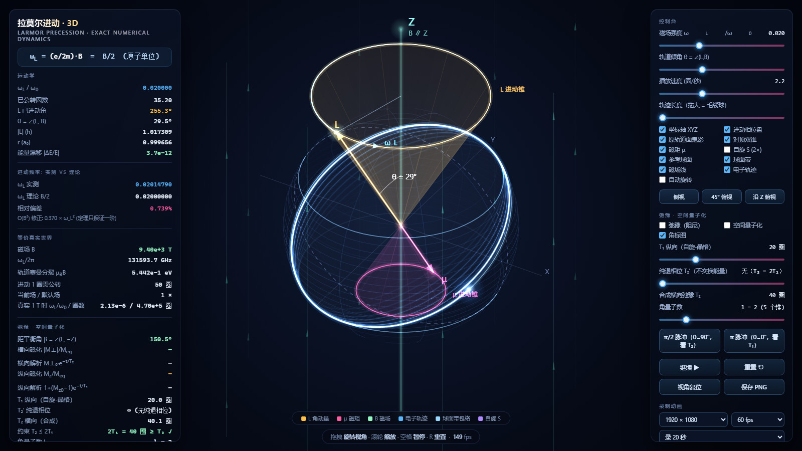
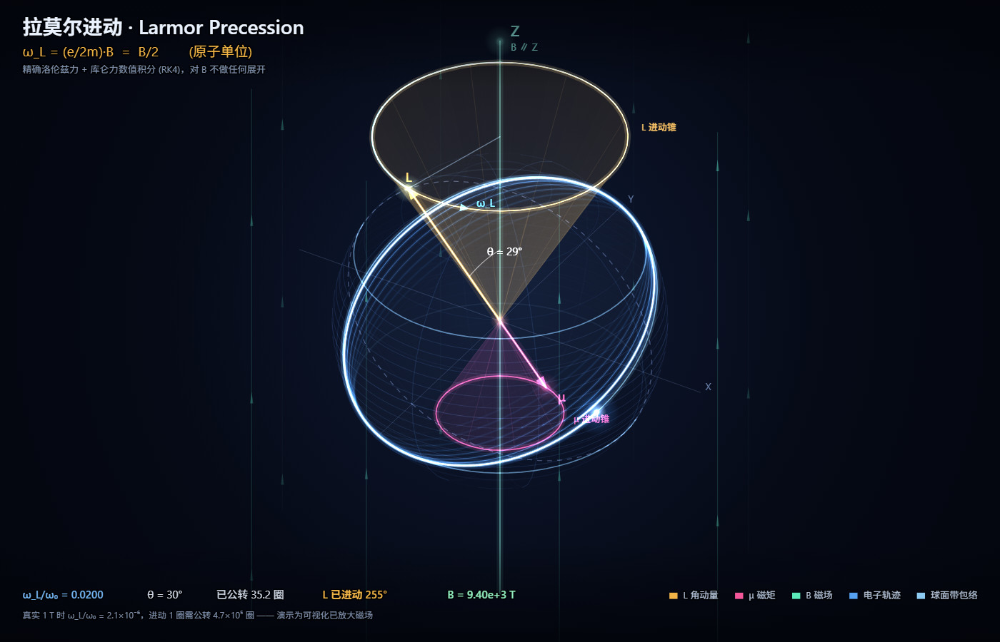
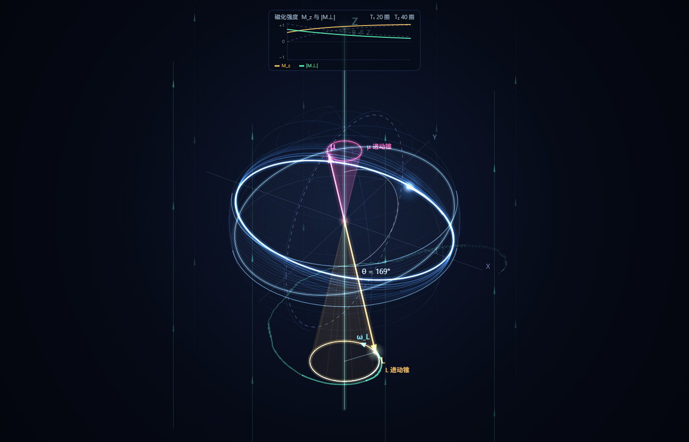
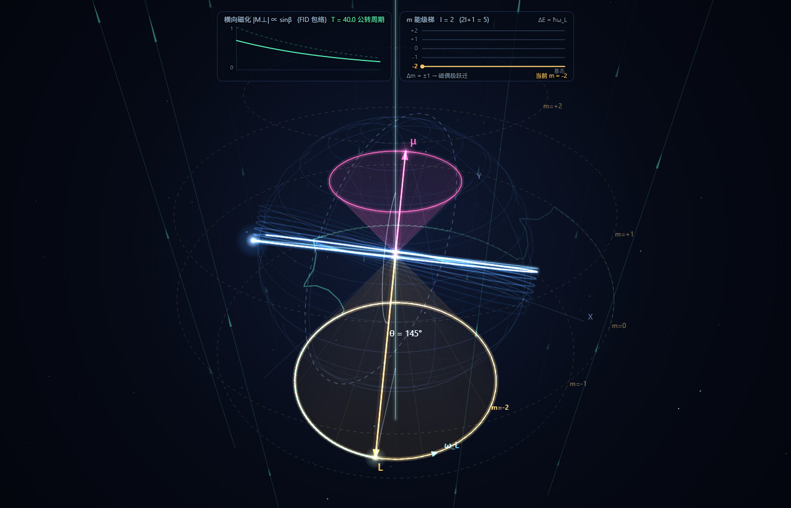
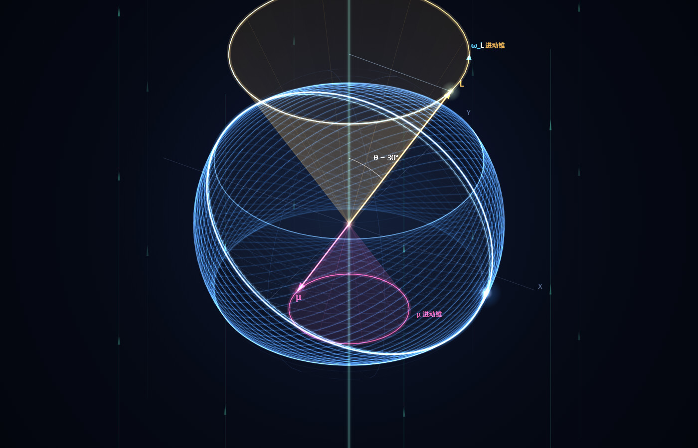

# 拉莫尔进动 · 3D 交互演示

一个**零依赖、可离线运行**的拉莫尔进动（Larmor Precession）演示。物理不是画出来的，是**数值积分精确运动方程涌现出来的**。

打开 `index.html` 即可（双击，或拖进浏览器）。不需要联网、不需要服务器。











---

## 一、为什么它"符合物理规律"

演示里积分的是**精确**的经典运动方程，对磁场 B **不做任何展开、不做任何近似**：

```
dr/dt = v
dv/dt = − r/|r|³  −  v × B          （原子单位：m_e = e = ħ = 1，核电荷 Z = 1）
```

* 第一项是原子核的库仑力，第二项是电子的洛伦兹力（电荷 q = −1）。
* 积分器：四阶龙格–库塔（RK4），步长 `2π/1800`（即每圈公转 1800 步）。
* 圆轨道 `r = a₀` 时：`v = 1`、`ω₀ = 1`、`E = −0.5`、周期 `T₀ = 2π`。

**拉莫尔进动频率 `ω_L = eB/2m = B/2` 从来不出现在代码里**——它是由积分结果反推出来、再和理论对照的。所以这个程序同时也是一台"拉莫尔定理检验机"。

### 初值的讲究

轨道取"磁场存在时仍为圆形"的那一条，即在 `r = a₀` 处做径向力平衡：

```
向心 v²/r = 库仑 1/r² + 磁场内向分量 v·B·cosθ
⇒ v₀ = 1/√r + (B/2)·cosθ
```

那个 `+(B/2)cosθ` 正是**轨道角频率的塞曼平移** Δω = ω_L·cosθ。取这个初值，整条轨道才会以 ω_L **刚性进动**（正是教科书图像）；若图省事取零场圆轨道速度，会得到一个 O(B) 偏心率的进动椭圆——物理同样正确，但不好看。副作用是 |L| = 1 + (B/2)cosθ 略大于 1ħ，界面上有注明。

---

## 二、数值验证结果（`node verify.js` 可复现）

### 1. 进动频率 = eB/2m，且偏差严格是 O(B²)

| ω_L/ω₀ | B(a.u.) | 进动 1 圈需公转 | 实测 ω_L | 理论 B/2 | 相对偏差 | 偏差/ω_L² | 能量漂移 |
|---|---|---|---|---|---|---|---|
| 0.001 | 0.002 | 1000 圈 | 0.001000250 | 0.001000000 | 0.0250% | **0.2500** | 1.4e−9 |
| 0.002 | 0.004 | 500 圈 | 0.002001000 | 0.002000000 | 0.0500% | **0.2500** | 6.9e−10 |
| 0.005 | 0.010 | 200 圈 | 0.005006247 | 0.005000000 | 0.1249% | **0.2499** | 2.8e−10 |
| 0.010 | 0.020 | 100 圈 | 0.010024977 | 0.010000000 | 0.2498% | **0.2498** | 1.4e−10 |
| 0.020 | 0.040 | 50 圈 | 0.020099798 | 0.020000000 | 0.4990% | **0.2495** | 7.6e−11 |
| 0.040 | 0.080 | 25 圈 | 0.040398145 | 0.040000000 | 0.9954% | **0.2488** | 4.2e−11 |
| 0.080 | 0.160 | 13 圈 | 0.081576525 | 0.080000000 | 1.9707% | **0.2463** | 2.8e−11 |

相对偏差随 B **线性**增长，但 `偏差/ω_L²` 恒定在 **0.25** ——也就是

```
ω_L(实测) = (B/2)·(1 + 0.25·B)      偏差是 O(B²)
```

这正是**拉莫尔定理"一阶精确"**的定量含义：`ω_L = eB/2m` 没有一阶误差，只有二阶修正。

演示默认倾角 θ = 30° 时，同样的检验给出的系数是 **0.43**（`verify.js` 会打印两张表）：

| ω_L/ω₀ @ θ=30° | 实测 ω_L | 理论 B/2 | 相对偏差 | 偏差/ω_L² |
|---|---|---|---|---|
| 0.005 | 0.005010823 | 0.005 | 0.2165% | **0.4329** |
| 0.010 | 0.010043276 | 0.010 | 0.4328% | **0.4328** |
| 0.020 | 0.020172958 | 0.020 | 0.8648% | **0.4324** |
| 0.040 | 0.040690237 | 0.040 | 1.7256% | **0.4314** |

**O(B²) 前面的系数依赖倾角 θ，但"偏差是 O(B²)"这一点与 θ 无关**——拉莫尔定理在任何倾角下都是一阶精确的。

### 2. 拉莫尔定理直接检验

把数值轨迹变换到"以 ω_L 绕 B 旋转"的参考系，应当与 B = 0 的圆轨道重合（固定 50 圈公转窗口）：

| ω_L/ω₀ | 旋转系中 RMS 偏差 | RMS偏差/ω_L² |
|---|---|---|
| 0.001 | 3.30e−4 | **329.9** |
| 0.002 | 1.32e−3 | **329.9** |
| 0.005 | 8.25e−3 | **329.9** |
| 0.010 | 3.30e−2 | **329.8** |
| 0.020 | 1.32e−1 | **329.2** |

比值恒定 ⇒ 旋转系中的偏差也是 O(B²) ⇒ **"在以 ω_L 旋转的参考系里，轨道与零场轨道重合"成立到一阶**。

### 3. 其他守恒量

* **能量守恒**：磁场不做功，E 必须严格守恒。实测相对漂移 ~1e−10（就是 RK4 的截断误差，与 B 无关）。
* **轨道形状**：半径相对波动 ~O(B²)（ω_L/ω₀=0.02 时为 5e−4）⇒ 磁场在一阶上**只让轨道进动，不改变它的形状**。
* 密切偏心率读数带一个 O(B) 的周期性振荡（磁场对速度的瞬时扰动），不代表轨道变椭——界面上不做此误导性读数。

---

## 三、画面里的每一件东西

| 元素 | 含义 |
|---|---|
| **一串旋转叠开的轨道环** | 电子的真实轨迹长曝光。每一圈是一个公转周期，相邻两圈绕 Z 轴差 7.2°（ω_L/ω₀ = 0.02 时）。把它拖长就变成"毛线球" |
| **白热亮环** | 最近一圈（当前轨道），电子就在上面跑 |
| **虚线环** | 进动起始时刻的轨道面（"鬼影"）。它和当前轨道环之间的夹角就是**已经进动的角度**，是判断"转了多少"最直接的参考 |
| **青色圆环 + 半径线 + 渐隐弧** | **进动相位盘**：L 矢端的水平轨迹圆、当前相位半径、以及往回 270° 的残影弧。旁边的切向箭头标出绕 Z 的转向，标着 ω_L |
| **金色圆锥** | L 的进动锥（边沿直接标着「L 进动锥」），半顶角 = min(θ, 180°−θ)，斜高 1.55·\|⟨L⟩\| |
| **品红圆锥** | μ 的进动锥（标着「μ 进动锥」），半顶角相同、斜高**正好一半** |
| **竖直薄荷色线** | 磁场 B，同时标出这就是 **Z 轴**（"B ∥ Z"） |
| **X / Y 淡色轴** | 赤道面内的坐标轴，给"绕 Z 转了多少"一个绝对参考 |
| **金色箭头 L** | 轨道角动量 |
| **品红箭头 μ** | 轨道磁矩，μ = −½L（原子单位） |
| **紫色箭头 S** | （可选）电子**自旋**，以 g≈2.0023 即约 2 倍频率进动 |

### 为什么默认是 θ = 30°、仰角 35°、关相机自转

这三点都是为了让**"绕 Z 轴匀速转动"**成为画面上第一眼就能读到的信息：

* **θ 小**（轨道面接近赤道面）时，进动看起来是"一圈环在平稳地绕竖直轴旋转"；θ = 60° 时轨道面近乎立起来，同样的运动看起来像"翻滚"，反而不容易认出是在绕 Z 转。
* **相机仰角**太低（比如 17°）时，进动锥被透视压扁成 3.4:1 的椭圆，矢端画的圆看起来像左右滑动；抬到 35° 左右锥面才张得开。
* **相机自转**会让整个画面一起转，观众分不清"到底是轨道在进动还是镜头在动"。所以默认关闭，需要氛围感时再勾。

右上角有三个视角预设：**侧视 / 45° 俯视 / 沿 Z 俯视**。其中"沿 Z 俯视"能最直观地看到轨道环绕 Z 叠开成扇面。

### 为什么用正交投影（而不是透视）

一开始用的是透视投影，好看，但**破坏了矢量图里最要紧的两条几何关系**。实测（录制 canvas 的真实描边、在屏幕坐标里量）：

| 配置 | 两箭杆方向夹角 | 屏幕长度比 \|μ\|/\|L\|（必须 = 0.500） |
|---|---|---|
| 默认 θ=30° | 0.00° ✓ | **0.267** ✗ |
| 弛豫 + 量子化 | 0.00° ✓ | 0.501 ✓ |
| 弛豫 θ=90° | 0.00° ✓ | **0.606** ✗ |
| 量子化 l=3 | 0.00° ✓ | **0.256** ✗ |

原因是 μ = −½L 让两个箭头**指向相反的深度方向**，透视下近的显长、远的显短，比值在 0.25~0.6 之间乱漂。
"μ 正好是 L 的一半"这个物理事实在屏幕上完全看不出来。

改成**正交（平行）投影**后，五个配置的屏幕比值全部精确等于 **0.500**，夹角全部 0.00°。
顺带一个额外好处：均匀磁场的场线本来就是平行的，正交投影下它们投影后仍然平行，更诚实。

> 这类"三维数学量对、屏幕上画出来不对"的 bug，数值断言一个都抓不到。
> 所以 	est-headless.js 现在会**录制 canvas 的真实描边调用**，在屏幕坐标里
> 检查 L / μ 两箭杆的共线性、反向性、长度比 0.5、以及是否都从原点画出。
### 为什么两个锥要直接标出归属

进动锥的**半顶角恒取 min(θ, 180°−θ)**，所以 θ 越过 90° 之后，金色锥会从"朝上"变成"朝下"——
虽然作为**方向集合**它和"绕 +Z、半顶角 θ"的锥完全等价，但肉眼看会觉得锥的归属变了。

更麻烦的是：**量子化打开时，这对进动锥会和某两根允许的 m 锥精确重合**（同一个曲面）。
例如 m=−2 基态下，金色 L 锥 ≡ m=−2 允许锥，品红 μ 锥 ≡ m=+2 允许锥。两套东西重叠画在一起，
再加上 m 标签常落在另一个锥附近，极易看成"μ 和 L 标反了"。

所以现在直接在锥的边沿标出「L 进动锥」/「μ 进动锥」。可以随时用一条不变式核对：

`
∠(L, μ) ≡ 180.000°        （μ = −½L 是原子单位下的精确关系, 永远严格反平行）
∠(L, 金色锥轴) ≡ 金色锥半顶角
∠(μ, 品红锥轴) ≡ 品红锥半顶角
`

实测（_probe3 已删除，数值见提交记录）：∠(L,μ) = **180.000°**，两个夹角与各自半顶角之差都是 **0.000°**，
L 精确落在 m=−2 锥上、μ 精确落在 m=+2 锥上。
### 关于"对顶双锥"

因为 μ = −(e/2m)L，在原子单位下就是 **μ = −½L**：μ 与 L 永远严格反平行。所以画在同一个顶点上时，L 的锥与 μ 的锥

* 共顶点、共轴
* 半顶角相等（都是 θ，但绕 ±B 方向）
* 开口相反

——**恰好构成一个对顶双锥**。而且斜高之比就是真实的物理比例 2:1（因为 |μ| = ½|L| 是原子单位下的精确关系，不是示意）。

注意：这个双锥是**矢量图里的对象**；电子在空间里扫出的是球面上的一条带，不是双锥。

---

## 四、真实量级换算（界面右侧实时显示）

程序内部用原子单位，界面同时给出真实世界换算：

* 原子单位磁场 `B₀ = ħ/(e a₀²) = 2.3505×10⁵ T`
* 氢原子 n=1 经典圆轨道角频率 `ω₀ = 4.1341×10¹⁶ rad/s`（= 6.58×10¹⁵ Hz）
* 轨道拉莫尔频率 `ω_L/2π = 13.996 GHz/T`；自旋 `27.99 GHz/T`（g = 2.0023）

**关于放大倍数（重要，不骗人）**：默认 `ω_L/ω₀ = 0.02` 对应 **B ≈ 9402 T**，比 1 T 放大了约 9400 倍。
真实的 1 T 磁场下 `ω_L/ω₀ = 2.13×10⁻⁶`，**轨道面进动一圈电子要公转 47 万圈**——按真实比例根本看不出进动。所以演示里必须放大，界面里也一直显示着"当前场/默认场"和"真实 1 T 时"的对照。

---

## 五、弛豫与空间量子化（两层可选物理）

打开右侧「弛豫 · 空间量子化」里的两个开关即可。**这两层是演示之上的唯象/半经典补充，不是第一性原理**，界面里也这么标。

### 5.1 弛豫：纵向 T₁ 与横向 T₂ 是两个独立过程

对磁矩 μ ∝ −L 写标准布洛赫方程组：

```
M_z(t)   = M_eq + (M_z(0) − M_eq)·e^(−t/T₁)      纵向恢复  (M_eq 沿 +Z)
|M_⊥|(t) = |M_⊥|(0)·e^(−t/T₂)                    横向退相位
```

|  | **T₁ 纵向（自旋-晶格）** | **T₂ 横向（自旋-自旋 / 退相位）** |
|---|---|---|
| 衰减对象 | 纵向磁化 M<sub>z</sub> 回到平衡值 M<sub>eq</sub> | 横向磁化 M<sub>⊥</sub>，也就是**进动的那个分量** |
| 要不要交换能量 | **要**——把 ħω_L 交给晶格（声子、热库） | **不要**——可以纯粹是相位被打乱 |
| 温度依赖 | 强依赖 | 纯退相位部分几乎不依赖 |
| 物理来源 | 局域场涨落谱在 ω_L 处的分量 J(ω_L) | 局域场不均匀、翻转-翻转相互作用 |
| 测量方法 | **反转恢复**（π 脉冲） | **自旋回波 / CPMG** |
| 量级 | 核自旋可长达小时；顺磁离子可短到 ms | 一般 T₂ ≤ 2T₁ |

关键的物理约束是

```
1/T₂ = 1/(2T₁) + 1/T₂′        ⟹   T₂ ≤ 2T₁
```

`T₂′` 是**纯退相位**（不交换能量那一部分）。所以**即使一点纯退相位都没有，横向弛豫也不可能比纵向弛豫慢两倍以上**——这是个非平凡的结果。

界面上因此给了**两个独立滑杆**：

* **T₁ 纵向（自旋-晶格）**：4 ~ 1200 公转周期（对数）
* **纯退相位 T₂′**：0（无）~ 很快。拉到 0 时严格 T₂ = 2T₁

界面会实时显示合成出来的 T₂ 和 `2T₁ ≥ T₂ ✓` 的校验。你可以亲手验证：**无论怎么调，T₂ 都挤不过 2T₁**。

### 5.2 两种脉冲协议，分别看 T₁ 和 T₂

面板上两个按钮，对应磁共振里两个最标准的实验：

**π/2 脉冲（θ = 90°）→ 看 T₂（FID）**
把磁矩扳到横向平面。角标图里两条曲线**交叉**：`|M⊥|` 从 1 按 e^(−t/T₂) 衰减，`M_z` 从 0 按 1−e^(−t/T₁) 恢复。三维画面里对顶双锥**单调收口**直至塌成一条线、进动停止，L 矢端留下**向内收的绿色螺线**，金色 L 转到竖直向下、品红 μ 转到竖直向上（因为电子的 μ = −(e/2m)L，平衡态是 **L 反平行于 B、μ 平行于 B**）。

**π 脉冲（θ = 0°）→ 看 T₁（反转恢复）**
磁矩被整个翻到 −Z。这时**横向分量恒为 0**，所以：角标图里 |M⊥| 一条直线压在 0 上，而 M_z 从 **−1 穿过 0 回到 +1**；三维画面里**根本没有进动锥**（横向为零就没有锥），只有一根金色箭头从竖直向上翻到竖直向下——纯粹的纵向弛豫。

### 5.3 空间量子化

打开后，连续的进动锥被换成**只有 2l+1 个允许的锥**：

```
cos θ_m = m / √(l(l+1)) ,   m = −l … +l
```

l = 2 时是 35.3° / 65.9° / 90° / 114.1° / 144.7° 五根，画成虚线圆并标出 m。当前态那根高亮加粗——**状态只能在允许的锥之间"跳"，不再连续变**。

> **实现上的一个坑（值得记一下）**：轨道面是**无向**的——面倾角 p 与 180°−p 是同一个面，
> 所以 l=2 的**面倾角**只有 35.3° / 65.9° / 90° 三个值，其中 35.3° **同时对应 m=−2 和 m=+2**。
> 因此量子数 m 必须由**有向**的布洛赫倾角决定，绝不能由驱动后的几何倾角决定——
> 否则高亮会在 +m 和 −m 之间来回乱跳（先 +2 掉到 −2、再回 0、再掉 −2）。
>
> 第二个坑更隐蔽：**约束轨道面的驱动器一度把拉莫尔进动抵消掉了**。精确积分本身就带一个
> O(B) 章动（倾角在 ~0.6° 内起伏），驱动器每帧都去"镇压"它，而这些绕 r̂ 的修正带有
> **系统性的方位角分量**，累积起来足以吃掉进动。实测方位角速率从 15.8°/s 掉到 **1.5°/s**——
> 看上去就是"箭头几乎不转、只是在抖"。修法是给驱动器加 **0.025 rad 死区**，只在偏差超过
> 死区时才动（量子跃迁是 30° 量级，远大于死区，所以 snap 照旧干脆）。
>
> 修好后实测（ω_L/ω₀ = 0.02，2.2 圈/秒，理论进动一圈 22.7 s ≈ 15.8°/s）：

| 配置 | L 方位角速率 | 倾角行为 |
|---|---|---|
| 默认（无弛豫无量子化） | **15.8°/s** ✓ | 29.5°，含 0.57° 自然章动 |
| 只开空间量子化 | **14.7°/s** ✓ | 锁定在 35.26°（m=+2） |
| 弛豫 + 量子化 | **13.3°/s** ✓ | 35.3° → 65.9° → 90°，m 单调下梯 |

两个纯量子效应在画面里直接可见：

* **L 永远不能与 −Z 重合。** 最小夹角 θ_min = arccos√(l/(l+1))（l 大时 ≈ 1/√l 弧度）。l=2 时是 35.3°，所以弛豫到基态后 L 停在距 −Z 轴 35.3° 处，**到不了轴上**。
* **基态是 m = −l。** 弛豫 + 量子化一起开时，倾角会一级一级跳到 35.3°（m = −2）然后停住。

右侧角标图画 **m 能级梯**：E_m = m·ħω_L，标出基态、当前 m，以及只有 **Δm = ±1** 才有磁偶极跃迁（这正是"以 ω_L 进动"在量子语言里的身份——**拉莫尔进动就是 Δm=±1 的塞曼相干在演化**）。

### 5.4 数值验证（`node test-headless.js` 的实测输出）

```
弛豫验证(π/2 脉冲启动):
  T₁ = 30 圈(纵向/自旋-晶格),  纯退相位 = 无,  T₂ = 60 圈  → T₂ = 2T₁ ✓
  初始: M_z/M_eq = -0.000 (π/2 脉冲后应为 0),  |M⊥|/M_eq = 1.000 (应为 1)
   圈数  |  β 实测 |  β 布洛赫 |  M_z 实测 |  M_z 解析 |  |M⊥| 实测 |  |M⊥| 解析
    14.0  |   65.1° |     64.8° |   0.3730  |   0.3730  |   0.7919   |   0.7919
    28.0  |   46.3° |     45.9° |   0.6068  |   0.6068  |   0.6270   |   0.6270
    42.0  |   33.6° |     33.4° |   0.7535  |   0.7535  |   0.4965   |   0.4965
    56.0  |   25.1° |     24.9° |   0.8454  |   0.8454  |   0.3932   |   0.3932
    70.0  |   19.1° |     19.0° |   0.9031  |   0.9031  |   0.3114   |   0.3114
    98.0  |   11.5° |     11.5° |   0.9619  |   0.9619  |   0.1952   |   0.1952
  → 轨道面倾斜与布洛赫解最大偏差 0.32° ✓
  → M_z 与 |M⊥| 对解析解的最大偏差 7.8e-13 ✓
  → |M⊥|: 0.79 → 0.63 → 0.50 → 0.39 → 0.31 → 0.25 → 0.20   (按 e^(−t/T₂) 衰减)
  → M_z : 0.37 → 0.61 → 0.75 → 0.85 → 0.90 → 0.94 → 0.96   (按 1−e^(−t/T₁) 恢复)
加上纯退相位后: T₂ = 6.0 圈 < 2T₁ = 60 圈 ✓ (T₂ ≤ 2T₁ 约束成立)
π 脉冲(反转恢复): 初始 M_z/M_eq = -1.000, |M⊥|/M_eq = 0.000
  演化后 M_z/M_eq = 0.377, 全程 max|M⊥| = 0.0e+0 → 纯纵向弛豫, 没有横向信号 ✓
空间量子化: l = 2, 2l+1 = 5 个允许的有向 β 值 = 35.3°, 65.9°, 90.0°, 114.1°, 144.7°
  最小夹角 θmin = 35.3° → L 永远到不了 −Z 轴上
  起点: θ=30°, β=150.0° ⇒ m=2
  量子数阶梯: m 2 → 1 → 0 → -1 → -2
  → 单调下梯, 无来回跳 ✓
  → 轨道面已落在允许倾角上 ✓ (β = 35.3°, 对应 m=-2)
```

### 5.5 这两层没有做的事

* 弛豫是**唯象**的，没有从第一性原理（声子谱、碰撞截面）算 T₁ / T₂
* 三维画面里画的是**系综平均 ⟨L⟩**：方向由布洛赫解给出，**长度 ∝ |⟨L⟩|**（所以反转恢复时箭头会缩成一个点再反向长出来，这正是布洛赫矢量的行为），而电子轨道本身始终是 r = a₀ 的圆
* 空间量子化只做了**方向量子化**（矢量模型），没有做波函数 |ψ_lm|² 的电荷云演化和真实退相干——那是下一步
* 依然没有辐射、没有多原子系综、没有自旋-轨道耦合

---

## 六、录制动画

右侧面板底部有**「录制动画」**区，直接输出视频文件，不需要任何外部工具或录屏软件。

| 选项 | 说明 |
|---|---|
| 分辨率 | 1280×720 / 1920×1080 / 2560×1440（渲染分辨率与窗口无关，纯像素级输出） |
| 帧率 | 30 / 60 fps |
| 时长 | 10 / 20 / 30 / 60 秒，或 **1 个进动周期（无缝循环）** |
| 录制前重置 | 从空球开始录，视频里能看到"毛线球"一点点绕起来 |
| 烧录标题数据 | 把标题、公式、实时数据和图例画进画面里 |
| ● 开始录制 | 录完自动下载（WebM/VP9，浏览器支持时优先 MP4/H.264） |

录制期间画布会切到目标分辨率（缩略居中显示），面板上有红色进度条和计时。

### 关键点

1. **录的是 canvas 本身**（`canvas.captureStream()` + `MediaRecorder`），所以视频里**不会出现那些控制面板**——直接就是干净的画面。要在视频里带上标题和物理数据，就勾"烧录标题数据"。
2. **无缝循环**：选"1 个进动周期"时，录制长度取 `round(1/(ω_L/ω₀))` 圈公转。当 `ω_L/ω₀ = 1/n`（默认 0.02 = 1/50）时，首尾的**轨道面和电子相位同时回到原位**，得到的视频可以无限循环播放而看不出接缝。界面会提示"可无缝循环 ✓"；若是 0.03 这类非 1/n 的值，会提示"首尾有小缺口"。
3. **实时录制**：`captureStream` 按真实时间打时间戳，所以 20 秒的视频就要录 20 秒，播放速度必然正确。如果机器跟不上（面板底部有 fps 显示），把分辨率降到 720p 或帧率降到 30。
4. 想更慢更顺滑的动画：把"播放速度"滑杆调小（比如 1.0 圈/秒），这样每圈公转能摊到 60 帧。
5. 转成 MP4 / GIF：

```bash
ffmpeg -i larmor-1920x1080-60fps.webm -c:v libx264 -pix_fmt yuv420p larmor.mp4
ffmpeg -i larmor-1920x1080-60fps.webm -vf "fps=25,scale=900:-1:flags=lanczos,split[a][b];[a]palettegen[p];[b][p]paletteuse" larmor.gif
```

---

## 七、操作

| 操作 | 效果 |
|---|---|
| 拖拽 | 旋转视角 |
| 滚轮 | 缩放 |
| 空格 | 暂停 / 继续 |
| R | 重置 |
| 磁场强度滑杆 | 改变 ω_L/ω₀（平滑调场，准静态，避免非绝热激发） |
| 轨道倾角 θ | 改变 L 与 B 的夹角（会重置，因为 θ 是初值）。默认 30°；调到 60° 以上锥面更壮观但进动更难认 |
| 轨迹长度 | 0 = 一串叠开的轨道环（最易读）；100 = 毛线球（最好看） |
| 坐标轴 XYZ / 进动相位盘 / 原轨道面鬼影 | 三个专门为"看清绕 Z 转动"加的辅助图层 |
| 视角预设 | 侧视 / 45° 俯视 / 沿 Z 俯视 |
| 复选框 | 分别开关球面 / 球带 / 对顶双锥 / μ / 自旋 / 场线 / 轨迹 / 自动旋转 |
| 保存 PNG | 把当前画面存成图片 |
| ● 开始录制 | 见上一节 |

### URL 参数（可做固定视角的分享链接）

```
?warmup=45        预跑 45 秒再开始（截图用，立刻就有饱满的轨迹）
?hud=0            隐藏所有面板（纯净壁纸模式）
?burn=1           打开画面烧录（标题 + 数据 + 图例）
?trail=100        轨迹长度拉满（0 = 一圈圈扇面，100 = 毛线球）
?theta=75&ratio=0.03        设定初值
?off=cone,field   关闭某些图层；?on=spin 打开某些图层
?az=-1.02&el=0.62&dist=3.25&zoom=1.15     设定相机
?auto=0&paused=1  关自动旋转 / 开局暂停
```

例：`index.html?warmup=45&hud=0&burn=1`

---

## 八、文件

| 文件 | 说明 |
|---|---|
| `index.html` | 页面 + 玻璃拟态控制面板（打开这个） |
| `physics.js` | 精确动力学：洛伦兹 + 库仑，RK4。可被 Node `require` |
| `app.js` | 自写透视投影 + Canvas2D 渲染器，无第三方库 |
| `verify.js` | `node verify.js` 打印上面第二节的全部验证表格 |
| `test-headless.js` | `node test-headless.js` 用 DOM 桩件把渲染器和 UI 全跑一遍 |

```bash
node verify.js          # 物理验证
node test-headless.js   # 渲染器冒烟测试
```

---

## 九、已知的诚实边界

1. **量子力学里电子没有轨迹**。这里是半经典波包/对应原理图像；真正的可测量是能级分裂 ΔE = m_l μ_B B。定态 |ψ|² 不随时间变化。
2. **经典加速电子会辐射**，真实的经典氢原子约 10⁻¹¹ s 就塌了。程序完全忽略辐射——原子能存在靠的是量子定态。
3. **只保证一阶**。ω_L ≪ ω₀ 的要求由滑杆上限（ω_L/ω₀ ≤ 0.06）保证。强场下轨道会被压成朗道能级，整套图像失效。
4. **均匀场假设**。程序用的是严格均匀场；真实磁铁有梯度，会在轨道尺度上引入梯度力。
5. 初值取的是"磁场中一阶圆轨道"，所以 |L| = 1 + (B/2)cosθ 略大于 1ħ。
